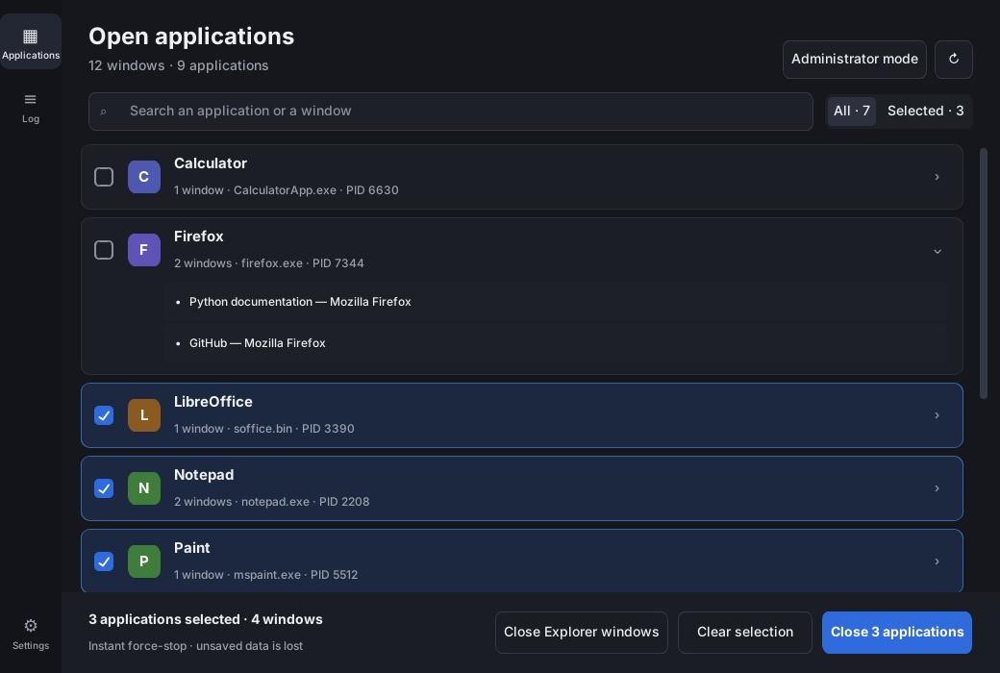
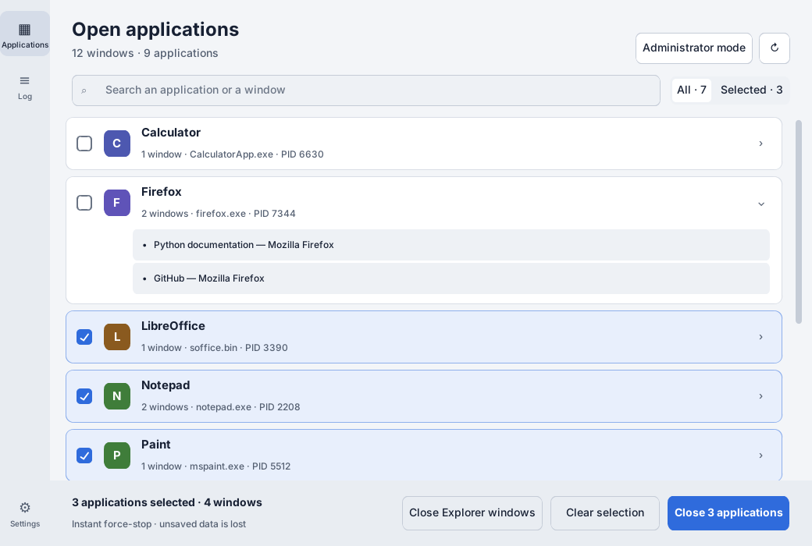
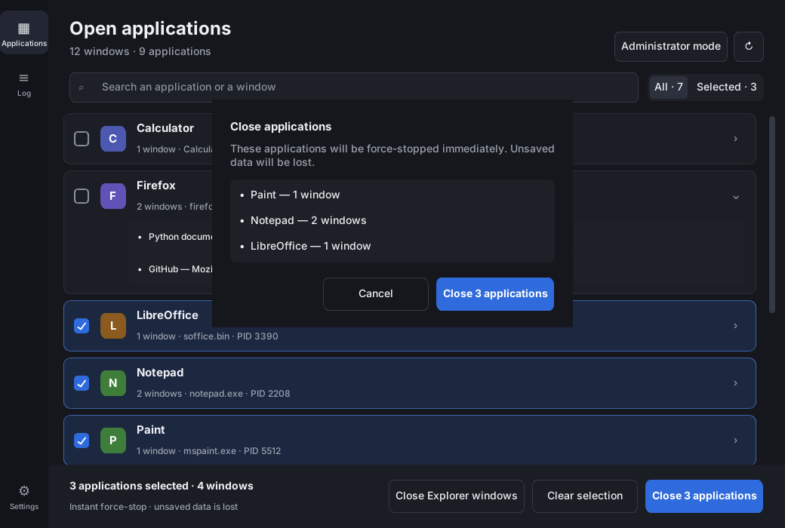
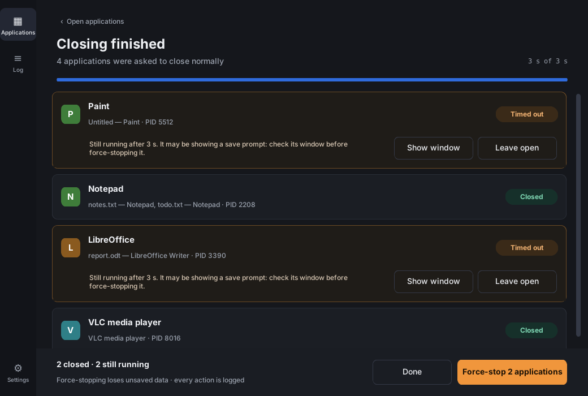
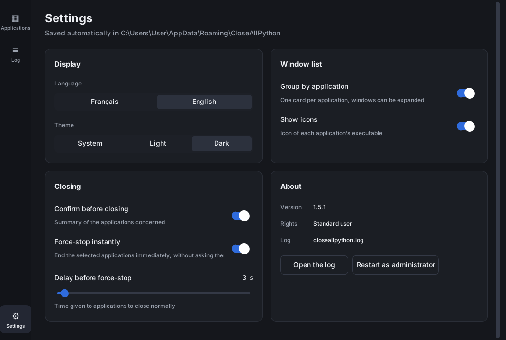
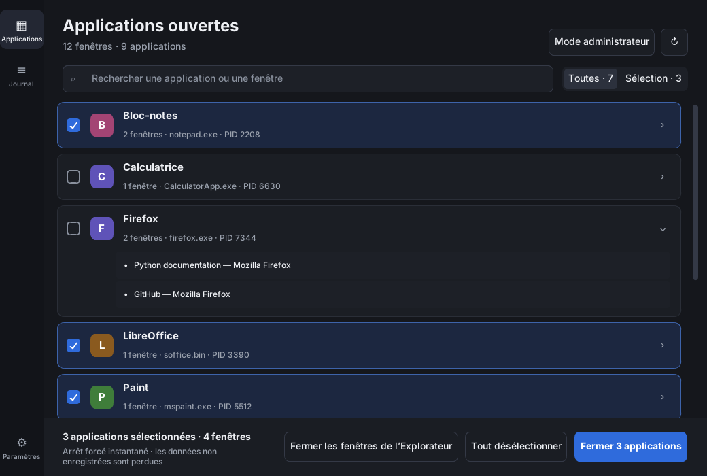
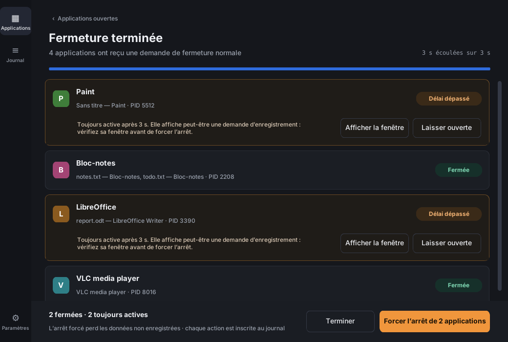

<div align="center">


# CloseAllPython

**Close every open application on Windows in one click, safely.**


[](LICENSE)

[English](#english) · [Français](#français)



</div>

---

<a id="english"></a>

## English

CloseAllPython lists the windows you see in Alt+Tab and closes the applications that own them: one by one, a selection, or all of them. It is built for the moments when you want a clean desktop fast (end of the day, before a presentation, after a long debugging session) without killing anything Windows itself needs.

### Features

- **Instant close.** Selected applications are force-stopped immediately (`TerminateProcess`); no waiting delay.
- **Graceful mode (optional).** Applications are asked to close normally (`WM_CLOSE`) so they can show their save prompts; after a delay you choose what to do with the survivors.
- **Windows stays usable.** Shell processes (Explorer, ApplicationFrameHost, TextInputHost…) are listed apart and can never be closed.
- **No wrong target.** Before acting, each process ID is checked against its creation time, so a recycled PID is never killed.
- **Close Explorer windows.** Closes every File Explorer folder window (all tabs) while the desktop and taskbar keep running.
- **Always up to date.** The list refreshes by itself after a closing; icons load in the background.
- **Command line.** Scriptable `--no-ui` mode with dry run, filters and exit codes.
- **Logged.** Every action goes to a log file; unexpected errors are shown and saved to `crash.txt`.
- Light, dark or system theme · English and French · sharp on high-DPI screens.

> [!WARNING]
> By default, applications are force-stopped: **unsaved data is lost**. Turn off *Force-stop instantly* in the settings (or use `--graceful` in the command line) to let applications ask you to save first.

### Screenshots

| Open applications (light theme) | Confirmation |
| --- | --- |
|  |  |

| Graceful mode: closing screen | Settings |
| --- | --- |
|  |  |

### Download

Get `CloseAllPython.exe` (graphical application) and `CloseAllPython-CLI.exe` (command line) from the [Releases](../../releases) page. No installation: run the executable. Windows 10 or 11 is required.

To close applications that run as administrator, use **Administrator mode** in the application.

### Usage

1. **Applications**: one card per application (name, icon, number of windows, PID). Tick the applications to close, expand a card to see its windows, search with <kbd>Ctrl</kbd>+<kbd>F</kbd>, refresh with <kbd>F5</kbd>.
2. Click **Close**. A confirmation lists the applications concerned (can be turned off).
3. In graceful mode, the **closing screen** shows the status of each application. One still running after the delay can be brought to the front (to answer a save prompt), left open, or force-stopped.

Closing an application closes all of its windows. The **Log** screen shows the latest actions; **Settings** are saved automatically.

### Command line

```bat
CloseAllPython-CLI.exe --no-ui --close "notepad" --dry-run
CloseAllPython-CLI.exe --no-ui --close "notepad"
CloseAllPython-CLI.exe --no-ui --close "notepad" --yes --graceful --timeout 10
CloseAllPython-CLI.exe --no-ui --all --dry-run
CloseAllPython-CLI.exe --no-ui --close-explorer
```

| Option | Effect |
| --- | --- |
| `--no-ui` | command-line mode (required by every option below) |
| `--close TEXT` | applications with a window title containing TEXT (case-insensitive, must not be empty) |
| `--all` | every application with a visible window; must be explicit |
| `--dry-run` | only list what would be closed |
| `-y`, `--yes` | no confirmation (required when there is no interactive console) |
| `--force` | force-stop immediately (default behaviour, kept for compatibility) |
| `--graceful` | ask applications to close normally and wait for `--timeout` instead |
| `--timeout SECONDS` | wait time, 0–600 (default: the setting of the graphical application) |
| `--close-explorer` | close only the File Explorer windows (the process is not touched) |
| `--version` | print the version |

The command line never closes itself, the terminal it runs in, or its parent processes.

| Exit code | Meaning |
| :---: | --- |
| `0` | success |
| `1` | an application is still running or failed to stop, or the user answered no |
| `2` | invalid arguments, or no console to confirm |

### Files

| File | Content |
| --- | --- |
| `%APPDATA%\CloseAllPython\settings.json` | settings |
| `%APPDATA%\CloseAllPython\closeallpython.log` | action log |
| `%APPDATA%\CloseAllPython\crash.txt` | details of the last unexpected error |

### Build from source

1. Install Python 3.14 from [python.org](https://www.python.org/downloads/) (with the `py` launcher).
2. Run `build.bat`. It creates a private `.venv`, installs the pinned dependencies, runs the tests, then builds `dist\CloseAllPython.exe` and `dist\CloseAllPython-CLI.exe` with PyInstaller.

Optional code signing: set `SIGN_CERT` (path to a `.pfx`) and `SIGN_PASSWORD` before running `build.bat` (needs `signtool` from the Windows SDK).

### Development

```bat
py -m venv .venv
.venv\Scripts\python -m pip install -r requirements-build.txt
.venv\Scripts\python -m unittest discover -s tests -t .
.venv\Scripts\python closeallpython.py
```

```text
closeallpython.py      entry point
closeall/
  winapi.py            every Win32 call
  core.py              window discovery and shutdown logic
  gui.py               CustomTkinter interface
  cli.py               command line
  settings.py, i18n.py settings, log, translations
  appicon.py, crash.py window icons, error reports
tests/                 unit tests (winapi replaced by an in-memory fake: they run outside Windows too)
```

See the [changelog](CHANGELOG.md) for the history of the project.

### License

CloseAllPython is released under the [MIT License](LICENSE): you may use, copy, modify and redistribute it freely, provided the copyright notice and the license text are kept. The software is provided without any warranty.

---

<a id="français"></a>

## Français

CloseAllPython liste les fenêtres visibles dans Alt+Tab et ferme les applications auxquelles elles appartiennent : une par une, une sélection, ou toutes à la fois. Il sert quand on veut un bureau propre rapidement (fin de journée, avant une présentation, après une longue séance de débogage) sans arrêter quoi que ce soit dont Windows a besoin.

<div align="center">

</div>

### Fonctionnalités

- **Fermeture immédiate.** Les applications sélectionnées sont arrêtées de force tout de suite (`TerminateProcess`), sans délai d'attente.
- **Mode normal (facultatif).** Les applications reçoivent une demande de fermeture normale (`WM_CLOSE`) et peuvent afficher leur demande d'enregistrement ; après un délai, vous décidez du sort des survivantes.
- **Windows reste utilisable.** Les processus du shell (Explorer, ApplicationFrameHost, TextInputHost…) sont listés à part et ne peuvent jamais être fermés.
- **Aucune erreur de cible.** Avant d'agir, chaque identifiant de processus est vérifié grâce à son heure de création : un PID recyclé n'est jamais tué.
- **Fermer les fenêtres de l'Explorateur.** Ferme toutes les fenêtres de dossiers de l'Explorateur de fichiers (tous les onglets) ; le bureau et la barre des tâches continuent de fonctionner.
- **Toujours à jour.** La liste s'actualise toute seule après une fermeture ; les icônes se chargent en arrière-plan.
- **Ligne de commande.** Mode `--no-ui` utilisable dans des scripts, avec simulation, filtres et codes de sortie.
- **Journalisé.** Chaque action est inscrite dans un journal ; les erreurs inattendues sont affichées et enregistrées dans `crash.txt`.
- Thème clair, sombre ou système · anglais et français · net sur les écrans haute densité.

> [!WARNING]
> Par défaut, les applications sont arrêtées de force : **les données non enregistrées sont perdues**. Désactivez *Arrêt forcé immédiat* dans les paramètres (ou utilisez `--graceful` en ligne de commande) pour laisser les applications vous proposer d'enregistrer.

### Capture d'écran

<div align="center">

</div>

### Téléchargement

Récupérez `CloseAllPython.exe` (application graphique) et `CloseAllPython-CLI.exe` (ligne de commande) sur la page [Releases](../../releases). Aucune installation : lancez l'exécutable. Windows 10 ou 11 est nécessaire.

Pour fermer des applications lancées en administrateur, utilisez **Mode administrateur** dans l'application.

### Utilisation

1. **Applications** : une carte par application (nom, icône, nombre de fenêtres, PID). Cochez les applications à fermer, développez une carte pour voir ses fenêtres, recherchez avec <kbd>Ctrl</kbd>+<kbd>F</kbd>, actualisez avec <kbd>F5</kbd>.
2. Cliquez sur **Fermer**. Une confirmation liste les applications concernées (peut être désactivée).
3. En mode normal, l'**écran de fermeture** affiche l'état de chaque application. Une application encore active après le délai peut être ramenée au premier plan (pour répondre à une demande d'enregistrement), laissée ouverte ou arrêtée de force.

Fermer une application ferme toutes ses fenêtres. L'écran **Journal** affiche les dernières actions ; les **Paramètres** sont enregistrés automatiquement.

### Ligne de commande

```bat
CloseAllPython-CLI.exe --no-ui --close "notepad" --dry-run
CloseAllPython-CLI.exe --no-ui --close "notepad"
CloseAllPython-CLI.exe --no-ui --close "notepad" --yes --graceful --timeout 10
CloseAllPython-CLI.exe --no-ui --all --dry-run
CloseAllPython-CLI.exe --no-ui --close-explorer
```

| Option | Effet |
| --- | --- |
| `--no-ui` | mode ligne de commande (requis par toutes les options ci-dessous) |
| `--close TEXTE` | applications dont un titre de fenêtre contient TEXTE (insensible à la casse, ne doit pas être vide) |
| `--all` | toutes les applications ayant une fenêtre visible ; doit être explicite |
| `--dry-run` | liste seulement ce qui serait fermé |
| `-y`, `--yes` | pas de confirmation (requis quand il n'y a pas de console interactive) |
| `--force` | arrêt forcé immédiat (comportement par défaut, conservé pour la compatibilité) |
| `--graceful` | demande aux applications de se fermer normalement et attend `--timeout` à la place |
| `--timeout SECONDES` | durée d'attente, 0–600 (par défaut : le paramètre de l'application graphique) |
| `--close-explorer` | ferme uniquement les fenêtres de l'Explorateur de fichiers (le processus n'est pas touché) |
| `--version` | affiche la version |

La ligne de commande ne se ferme jamais elle-même, ni le terminal dans lequel elle s'exécute, ni ses processus parents.

| Code de sortie | Signification |
| :---: | --- |
| `0` | succès |
| `1` | une application tourne encore ou n'a pas pu être arrêtée, ou l'utilisateur a répondu non |
| `2` | arguments invalides, ou pas de console pour confirmer |

### Fichiers

| Fichier | Contenu |
| --- | --- |
| `%APPDATA%\CloseAllPython\settings.json` | paramètres |
| `%APPDATA%\CloseAllPython\closeallpython.log` | journal des actions |
| `%APPDATA%\CloseAllPython\crash.txt` | détails de la dernière erreur inattendue |

### Compiler depuis les sources

1. Installez Python 3.14 depuis [python.org](https://www.python.org/downloads/) (avec le lanceur `py`).
2. Lancez `build.bat`. Il crée un `.venv` privé, installe les dépendances figées, lance les tests, puis compile `dist\CloseAllPython.exe` et `dist\CloseAllPython-CLI.exe` avec PyInstaller.

Signature de code facultative : définissez `SIGN_CERT` (chemin d'un `.pfx`) et `SIGN_PASSWORD` avant de lancer `build.bat` (nécessite `signtool` du SDK Windows).

### Développement

```bat
py -m venv .venv
.venv\Scripts\python -m pip install -r requirements-build.txt
.venv\Scripts\python -m unittest discover -s tests -t .
.venv\Scripts\python closeallpython.py
```

```text
closeallpython.py      point d'entrée
closeall/
  winapi.py            tous les appels Win32
  core.py              découverte des fenêtres et logique de fermeture
  gui.py               interface CustomTkinter
  cli.py               ligne de commande
  settings.py, i18n.py paramètres, journal, traductions
  appicon.py, crash.py icônes de fenêtre, rapports d'erreur
tests/                 tests unitaires (winapi remplacé par une simulation en mémoire : ils tournent aussi hors de Windows)
```

L'historique du projet se trouve dans le [journal des modifications](CHANGELOG.md).

### Licence

CloseAllPython est distribué sous [licence MIT](LICENSE) : vous pouvez l'utiliser, le copier, le modifier et le redistribuer librement, à condition de conserver la mention de copyright et le texte de la licence. Le logiciel est fourni sans aucune garantie. Seul le texte anglais du fichier `LICENSE` fait foi.
